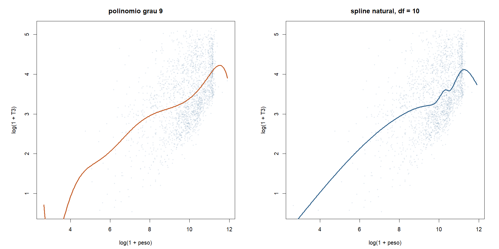
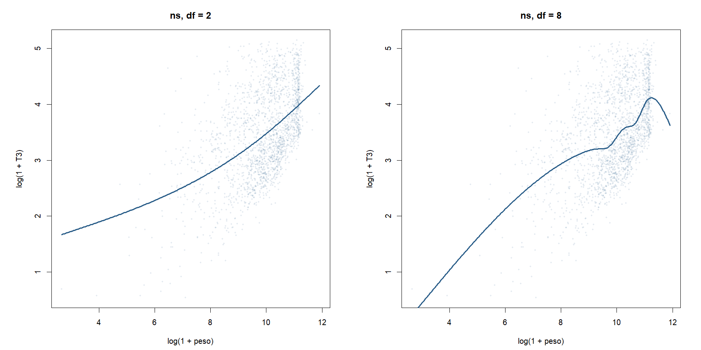
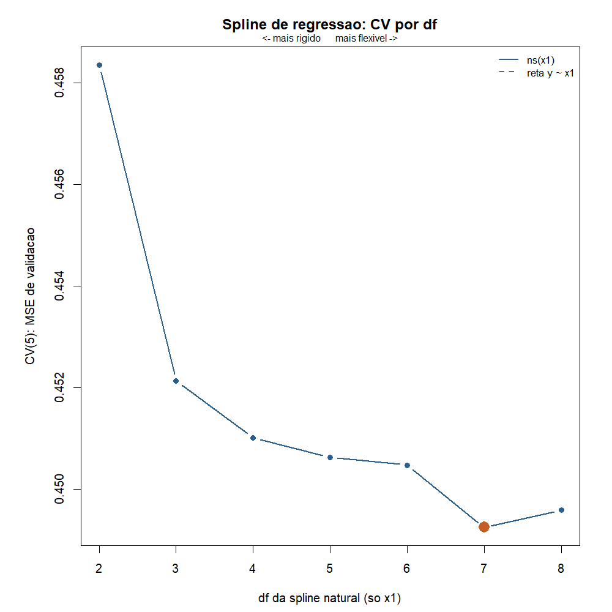
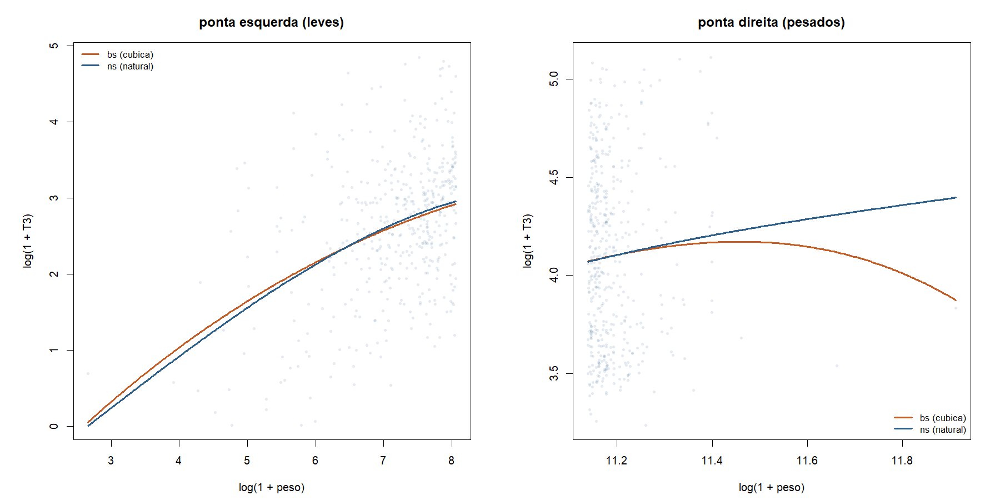
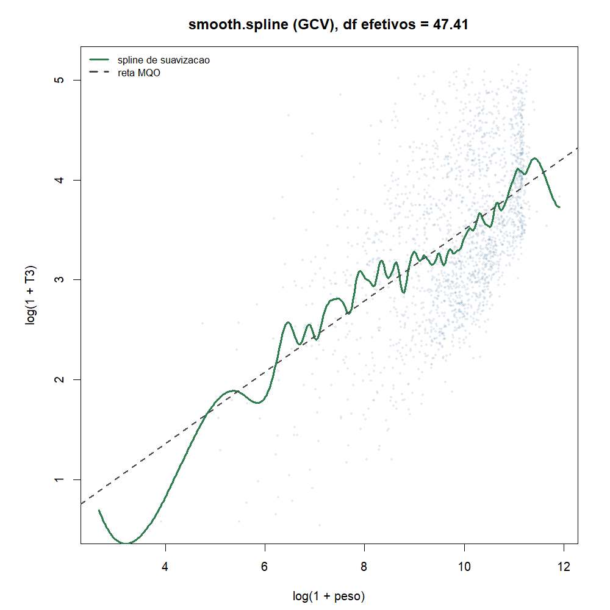
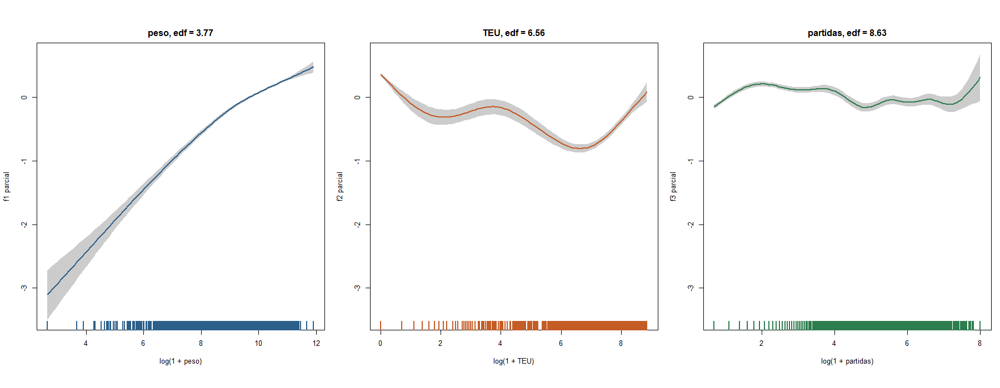
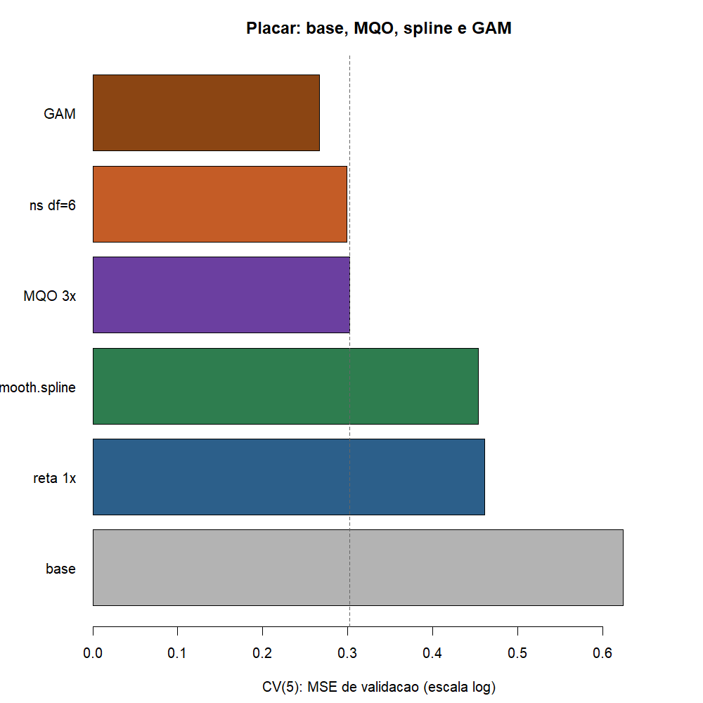

# Atividade 09 - Splines e modelos aditivos

**Team Shannon · Teoria do Aprendizado Estatístico · Fatec Rubens Lara · Aula 10**

Continua a [08](08-metodos-suavizacao.md): KNN e kernel decidem localmente,
mas achatam nas pontas e sofrem a maldição da dimensionalidade. A
[Aula 10](../materiais-aulas/Aula%2010%20-%20Splines%20e%20Modelos%20Aditivos.PDF)
responde com **pedaços emendados** (splines) e com a soma de curvas
suaves (GAM).

Script: [`09-splines-modelos-aditivos.R`](../estrutura/codigos/09-splines-modelos-aditivos.R).
Números: [`09-numeros.txt`](../estrutura/codigos/09-numeros.txt).
Pacotes: R base (`data.table` na leitura, `splines` com `ns`/`bs`,
`smooth.spline`) e `mgcv` para o GAM, como pede o laboratório da aula
(exceção no mesmo espírito do `glmnet` na 07).

---

## O funil

| # | Etapa | O que fizemos |
|---|---|---|
| 03a | Reta MQO | peso (+ TEU) |
| 05 / 06 | Avaliar | teste e CV |
| 07 | Expandir e frear | `glmnet` + λ por CV |
| 08 | Suavizar | KNN, kernel, loess |
| 09 | Splines / GAM | **esta entrega**: nós, penalidade, aditivo |

Recorte da ficha da Entrega 1: Santos 2024, movimentação de carga, peso > 0,
T3 até P99, **n = 5.681 escalas**. Resposta e preditores numéricos:

| Papel | Variável |
|---|---|
| y | log(1 + T3), T3 = tempo de operação em horas |
| x1 | `log.peso` = log(1 + peso bruto em t) |
| x2 | `log.teu` = log(1 + TEU) |
| x3 | `log.part` = log(1 + nº de partidas de carga) |

As mesmas 5 dobras (semente 1) servem para todos os métodos.

---

## 1. Por que a 08 pediu splines

Na 08 a média local (kernel) **achata** nas pontas: nos navios leves a janela
fixa pega poucos pontos e a curva oscila; o KNN alarga a janela e puxa a
predição para cima. O loess e o `smooth.spline` já corrigiam a borda, mas
ficaram como teaser.

A outra porta aberta era a **maldição**: com muitos preditores a vizinhança
some. A saída da aula é o GAM: uma curva suave por preditor, somadas, sem
exigir que a vizinhança viva em $\mathbb{R}^p$.

---

## 2. Splines de regressão: pedaços emendados

Em vez de um polinômio global (que oscila nas pontas quando o grau sobe),
cortamos o eixo em **nós** $\xi_1,\ldots,\xi_K$ e colocamos um polinômio
por pedaço. Na spline **cúbica**, pedimos que valor, primeira e segunda
derivadas coincidam em cada nó: a curva não quebra nem muda de curvatura
de súbito.

### Base truncada e MQO

```math
f(x)=\beta_0+\beta_1 x+\beta_2 x^{2}+\beta_3 x^{3}
+\sum_{k=1}^{K}\beta_{3+k}(x-\xi_k)_{+}^{3},
\qquad
(x-\xi)_{+}^{3}=
\begin{cases}
(x-\xi)^{3} & x>\xi\\
0 & x\le\xi
\end{cases}
```

Com $K$ nós sobram $K+4$ parâmetros livres. O ajuste é MQO sobre essa base.
No R, `bs()` (B-splines) gera outra base para as **mesmas** curvas, mais
estável numericamente; `ns()` força a spline **natural**: fora dos nós de
fronteira a curva é **reta**, o que corta a oscilação das pontas.

O botão é o **df** (graus de liberdade): df baixo ≈ quase reta; df alto ≈
mais nós, mais flexível. Quem escolhe é a CV.



Na esquerda o polinômio de grau 9 despenca e sobe nas pontas. Na direita a
natural com o mesmo orçamento de flexibilidade (df = 10) segue a nuvem sem
esse teatro nas bordas.





Só com `log.peso`, a CV(5) cai de 0,4583 (df = 2) até **0,4493** em df = 7
(contra 0,4609 da reta univariada). A curva da CV é um pouco serrilhada:
cada df muda os nós (quantis) e o espaço de ajuste de um salto.

Com os três preditores da ficha (`ns(x1, df) + x2 + x3`), o mínimo fica em
**df = 6**, CV = **0,2987** (contra 0,3019 do MQO linear nos três).



Nas pontas, a cúbica `bs` ainda pode curvar; a natural `ns` endireita. É o
mesmo remédio de borda que a aula contraste com o kernel.

---

## 3. Splines de suavização: RSS + pedágio de curvatura

A spline de suavização põe um nó em cada $x_i$ distinto e freia a curvatura
com um pedágio:

```math
\min_{g}\ \sum_{i=1}^{n}\bigl(y_i-g(x_i)\bigr)^{2}
+\lambda\int\bigl(g''(t)\bigr)^{2}\,dt
```

- $\lambda\to 0$: interpola (passa por todos os pontos);
- $\lambda\to\infty$: vira a reta MQO (segunda derivada zero).

A solução é uma cúbica natural "encolhida". No R: `smooth.spline`. O botão
prático são os **df efetivos** $\mathrm{tr}(S_\lambda)$; se não passamos
`df`, o GCV escolhe $\lambda$.



No nosso banco o GCV pediu df efetivos ≈ **47,4** e a CV(5) deu **0,4539**
(igual ao teaser da 08). É um modelo univariado: compete com a reta e o
kernel da 08, não com o MQO de três preditores.

A CV da spline de suavização costuma sair mais **lisa** que a da de
regressão: $\lambda$ (ou df efetivos) varia continuamente, sem saltos de
nós.

---

## 4. GAM: uma curva por preditor

```math
y_i=\beta_0+f_1(x_{i1})+f_2(x_{i2})+\cdots+f_p(x_{ip})+\varepsilon_i
```

Cada $f_j$ é uma spline (base + penalização). O pacote `mgcv` escolhe os
$\lambda_j$ por GCV. A hipótese forte é a **aditividade**: o efeito de
aumentar o peso não depende do TEU. Se houver interação forte, o GAM
erra a forma; a aula cita `ti()` para abrir uma porta, mas o laboratório
pede o aditivo puro.

Os **edf** de cada termo dizem se a curva é reta (edf ≈ 1) ou não.



| Termo | edf | Leitura |
|---|---:|---|
| `s(log.peso)` | 3,77 | sobe e depois achata: **não é reta** |
| `s(log.teu)` | 6,56 | sobe, desce e sobe de novo: bem longe de reta |
| `s(log.part)` | 8,63 | a mais flexível; oscila e a faixa de confiança abre onde há poucas escalas |

Frase do laboratório: o preditor que **mais** pede rever a forma linear é
`log.part` (edf 8,63), seguido de `log.teu` (6,56). O peso já era o mais
"quase linear" do funil, e mesmo assim o GAM lhe dá edf 3,77 (curvatura
leve no começo e no platô dos pesados).

A CV(5) do GAM foi **0,2669**, a melhor do placar. Em horas (RMSE na escala
original, via CV):

| Modelo | RMSE (h) |
|---|---:|
| linha de base (média) | 34,49 |
| MQO (3 preditores) | 26,57 |
| melhor `ns` (df = 6) + x2 + x3 | 26,35 |
| GAM | **25,49** |

O GAM bate a linha de base da ficha e ainda ganha cerca de 1 h do MQO.

---

## 5. Placar CV(5)



| Modelo | MSE (escala log) |
|---|---:|
| linha de base | 0,6241 |
| reta univariada (`y ~ x1`) | 0,4609 |
| `smooth.spline` (só x1) | 0,4539 |
| MQO (`y ~ x1+x2+x3`) | 0,3019 |
| `ns(x1, df=6)+x2+x3` | 0,2987 |
| **GAM** `s(x1)+s(x2)+s(x3)` | **0,2669** |

O salto grande não é spline vs reta em um preditor (ganho de ~2%, como na
08): é **entrar TEU e partidas** e depois **deixar cada um curvar**. A
spline natural em cima do MQO quase não mexe (0,3019 → 0,2987); o GAM
corta de 0,3019 para 0,2669 porque TEU e partidas não são retas.

---

## 6. Exercícios (gabarito comentado)

### Exercício 1 (cálculo): contagem de parâmetros

Spline cúbica com $K=4$ nós: quantos coeficientes têm os 5 polinômios
soltos, quantas restrições os nós impõem e quantos parâmetros sobram? E a
spline natural com esses 4 nós internos e os 2 de fronteira?

**Gabarito.**

1. Cinco pedaços × 4 coeficientes (cúbica) = **20** coeficientes soltos.
2. Em cada nó pedimos continuidade de valor, 1ª e 2ª derivadas: 3
   restrições × 4 nós = **12** restrições.
3. Sobram $20-12=8=K+4$ parâmetros livres.
4. A natural acrescenta que, fora dos nós de fronteira, a curva é reta
   ($g''=0$ nos dois extremos e além). Isso remove 4 graus de liberdade:
   sobram $8-4=4$ parâmetros para a parte não linear, ou **6** no total
   contando os 6 nós da base natural (4 internos + 2 de fronteira). Com o
   mesmo df, a natural tem **mais nós internos** que a cúbica solta: o
   orçamento que a solta gasta curvando nas pontas a natural gasta no
   miolo.

### Exercício 2 (cálculo): truncamentos

Seja $f(x)=100+2x+3(x-50)_{+}-4(x-80)_{+}$, com $(u)_{+}=\max(u,0)$.
Calcule $f(40)$, $f(50)$, $f(60)$ e $f(100)$ e a inclinação em cada pedaço.
A curva é contínua em $x=50$?

**Gabarito.**

| $x$ | $(x-50)_{+}$ | $(x-80)_{+}$ | $f(x)$ |
|---:|---:|---:|---:|
| 40 | 0 | 0 | $100+80=180$ |
| 50 | 0 | 0 | $100+100=200$ |
| 60 | 10 | 0 | $100+120+30=250$ |
| 100 | 50 | 20 | $100+200+150-80=370$ |

Inclinações:

- $x<50$: só o termo $2x$ → inclinação **2**;
- $50<x<80$: entra $+3(x-50)$ → inclinação **5**;
- $x>80$: entra ainda $-4(x-80)$ → inclinação **1**.

Em $x=50$, pela esquerda $f=200$ e pela direita
$100+2\cdot 50+3\cdot 0=200$: **contínua**. A inclinação salta de 2 para 5
(aqui a base é linear por pedaços, não cúbica: a 1ª derivada pode pular).

### Exercício 3 (cálculo): pedágio e critério penalizado

Em $[0,1]$, calcule $\int_0^1 (g''(t))^2\,dt$ de $g_1(x)=3+2x$,
$g_2(x)=x^2$ e $g_3(x)=x^3$. Três curvas candidatas têm RSS 52, 30 e 12 e
pedágios 0, 4 e 30: qual minimiza $\mathrm{RSS}+\lambda\int(g'')^2$ com
$\lambda=0{,}1$, $\lambda=1$ e $\lambda=10$?

**Gabarito.**

- $g_1''=0$ → pedágio **0** (é reta).
- $g_2''=2$ → $\int_0^1 4\,dt=4$.
- $g_3''=6t$ → $\int_0^1 36 t^2\,dt=12$.

Critério das candidatas A (RSS 52, pedágio 0), B (30, 4), C (12, 30):

| | $\lambda=0{,}1$ | $\lambda=1$ | $\lambda=10$ |
|---|---:|---:|---:|
| A | 52,0 | 52 | 52 |
| B | 30,4 | **34** | 70 |
| C | **15,0** | 42 | 312 |

- $\lambda=0{,}1$ (pouco freio): ganha **C** (aceita curvatura para baixar o RSS);
- $\lambda=1$: ganha **B**;
- $\lambda=10$ (muito freio): ganha **A**, a reta (pedágio zero).

É o mesmo dilema viés-variância da 08, agora escrito como RSS + pedágio.

### Exercício 4 (cálculo): predição no GAM

Um GAM deu $\hat\beta_0=340$ e, para um imóvel da aula,
$\hat f_{\mathrm{área}}=-20$, $\hat f_{\mathrm{praia}}=+60$ e
$\hat f_{\mathrm{idade}}=+26$. Qual é a predição? Se o imóvel estivesse a
2 km, com $\hat f_{\mathrm{praia}}=-11$, quanto ela mudaria - e por que só
um termo muda?

**Gabarito.**

```math
\hat{y}=340+(-20)+60+26=406
```

Com praia a 2 km:

```math
\hat{y}=340+(-20)+(-11)+26=335
```

A predição cai **71**. Só o termo da praia muda porque o GAM é **aditivo**:
cada $f_j$ depende só do seu preditor. Área e idade iguais ⇒ $f$ iguais;
muda a distância ⇒ muda só $f_{\mathrm{praia}}$. No porto a mesma lógica:
se só o TEU muda, só $f_2(\log.\mathrm{teu})$ mexe na soma.

### Exercício 5 (conceitual): global × por pedaços

Por que um polinômio de grau 10 oscila nas pontas e uma spline natural com
10 graus de liberdade não?

**Gabarito.**

O polinômio é **uma** fórmula para o eixo inteiro: para acompanhar um
detalhe no miolo ele precisa de grau alto, e grau alto explode longe do
centro (vimos na figura 01 e na 05 com grau 12). A spline natural parte o
eixo em pedaços, emenda com suavidade e, fora dos nós de fronteira, **força
reta**: o orçamento de flexibilidade fica no miolo, não nas pontas.

### Exercício 6 (conceitual): os dois botões

Qual é o botão da spline de regressão e qual o da spline de suavização?
Para que lado cada um aumenta a flexibilidade? Por que a curva de
validação cruzada da primeira saiu serrilhada e a da segunda, lisa?

**Gabarito.**

- Regressão: botão = **df** (número efetivo de parâmetros / nós). df
  **maior** → mais flexível.
- Suavização: botão = **λ** (ou df efetivos). λ **menor** (df efetivos
  maior) → mais flexível.
- A CV da regressão é serrilhada porque cada df troca a base de um salto
  (nós em quantis diferentes). A da suavização varia λ de forma contínua;
  o erro de validação acompanha sem degraus.

### Exercício 7 (conceitual): aditivo

O que o GAM supõe sobre os preditores? Dê um exemplo portuário em que essa
hipótese falha e diga o que o GAM erraria.

**Gabarito.**

Supõe **aditividade**: o efeito de um preditor não depende do valor dos
outros. Contraexemplo em Santos: o efeito de mais TEU no tempo de operação
pode ser forte em navio de contêiner e quase nulo em granel (TEU ≈ 0). O
GAM soma $f(\mathrm{teu})$ igual para os dois; ele **espalharia** o efeito
médio do TEU também sobre granéis, ou diluiria o efeito verdadeiro nos
contêineres. Interação pediria `ti(log.teu, fator)` ou um modelo por
natureza de carga.

### Exercício 8 (conceitual): o efeito de 1 unidade

A Autoridade Portuária quer "o efeito de 1% a mais de peso no T3". O GAM
responde? E "o efeito de uma partida de carga a mais"?

**Gabarito.**

- No **MQO log-log**, o coeficiente de `log.peso` é uma elasticidade
  (na 06, β ≈ 0,36). Um número só.
- No **GAM**, $f_1(\log.\mathrm{peso})$ tem **inclinação local**: o efeito
  de 1% a mais depende de onde o navio está na curva (figura 05: no começo
  a curva sobe; nos pesados ela achata). Dá para responder com a derivada
  num ponto, não com um único β.
- "Uma partida a mais" é ainda mais local: `log.part` tem edf 8,63 e a
  curva oscila. O GAM avisa que **não há efeito constante**; insistir num
  único número seria voltar ao MQO e mentir a forma.

---

## 7. Conclusão

1. Spline de regressão = polinômios por pedaço emendados; botão = df;
   natural (`ns`) endireita as pontas.
2. Spline de suavização = RSS + λ × pedágio de curvatura; botão = λ / df
   efetivos; GCV escolhe sozinho.
3. GAM = soma de splines, uma por preditor. Em Santos, TEU e partidas
   **não** são retas (edf 6,56 e 8,63); o peso curva pouco (edf 3,77).
4. Placar CV(5): GAM 0,2669 < ns+lineares 0,2987 < MQO 0,3019 << base
   0,6241. Em horas, o GAM faz 25,5 h contra 34,5 h da média e 26,6 h do
   MQO. A próxima aula (árvores) relaxa a aditividade.

---

## Como reproduzir

```r
Rscript estrutura/codigos/09-splines-modelos-aditivos.R
```

| Arquivo | Conteúdo |
|---|---|
| `01-polinomio-vs-natural.png` | grau 9 vs `ns` df = 10 |
| `02-ns-df-baixo-alto.png` | `ns` com df = 2 e df = 8 |
| `03-cv-ns-df.png` | CV(5) da spline de regressão (só x1) |
| `04-smooth-spline.png` | spline de suavização (GCV) |
| `05-gam-curvas-parciais.png` | $f_1$, $f_2$, $f_3$ do GAM |
| `06-placar-cv.png` | base, reta, MQO, ns, spline, GAM |
| `07-bs-vs-ns-pontas.png` | cúbica vs natural nas pontas |

*Fonte: ANTAQ, Santos 2024.*
