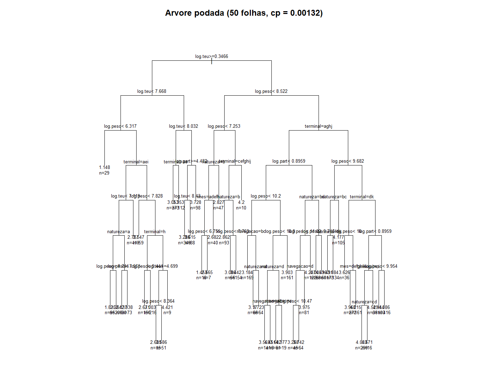
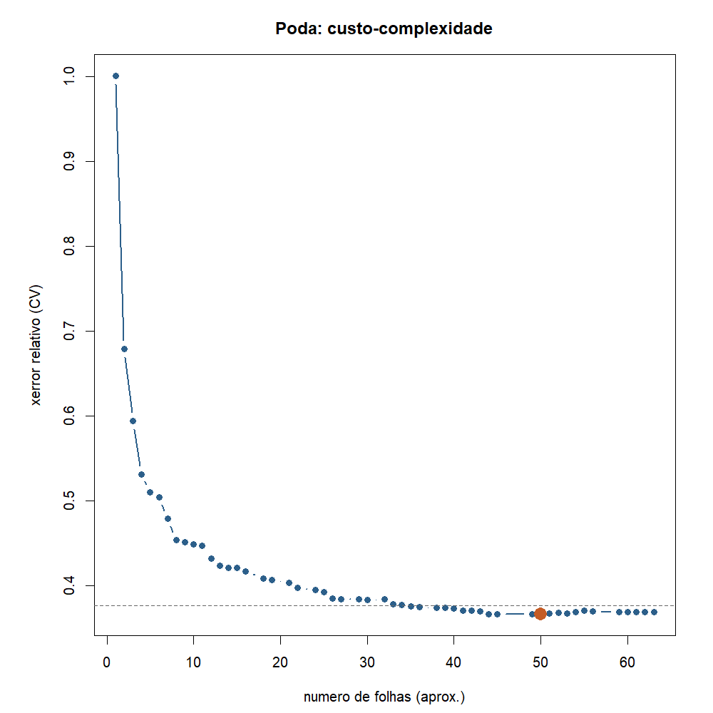
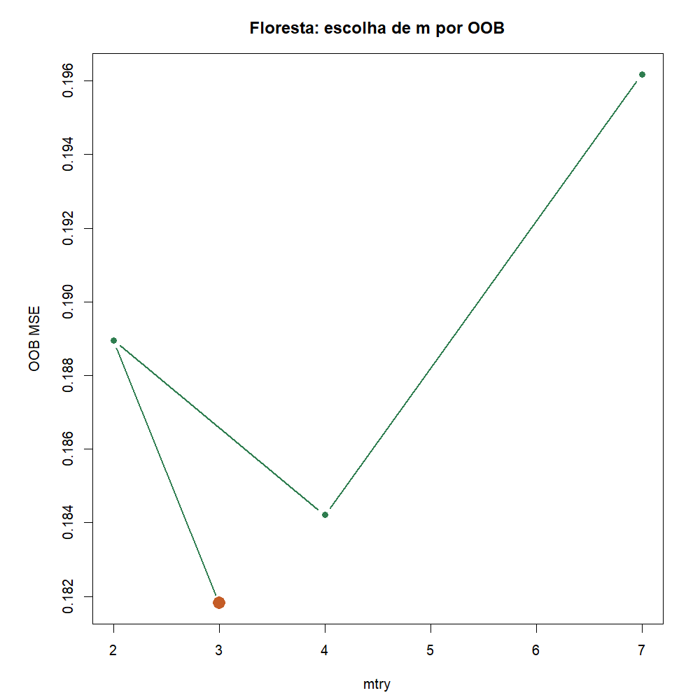
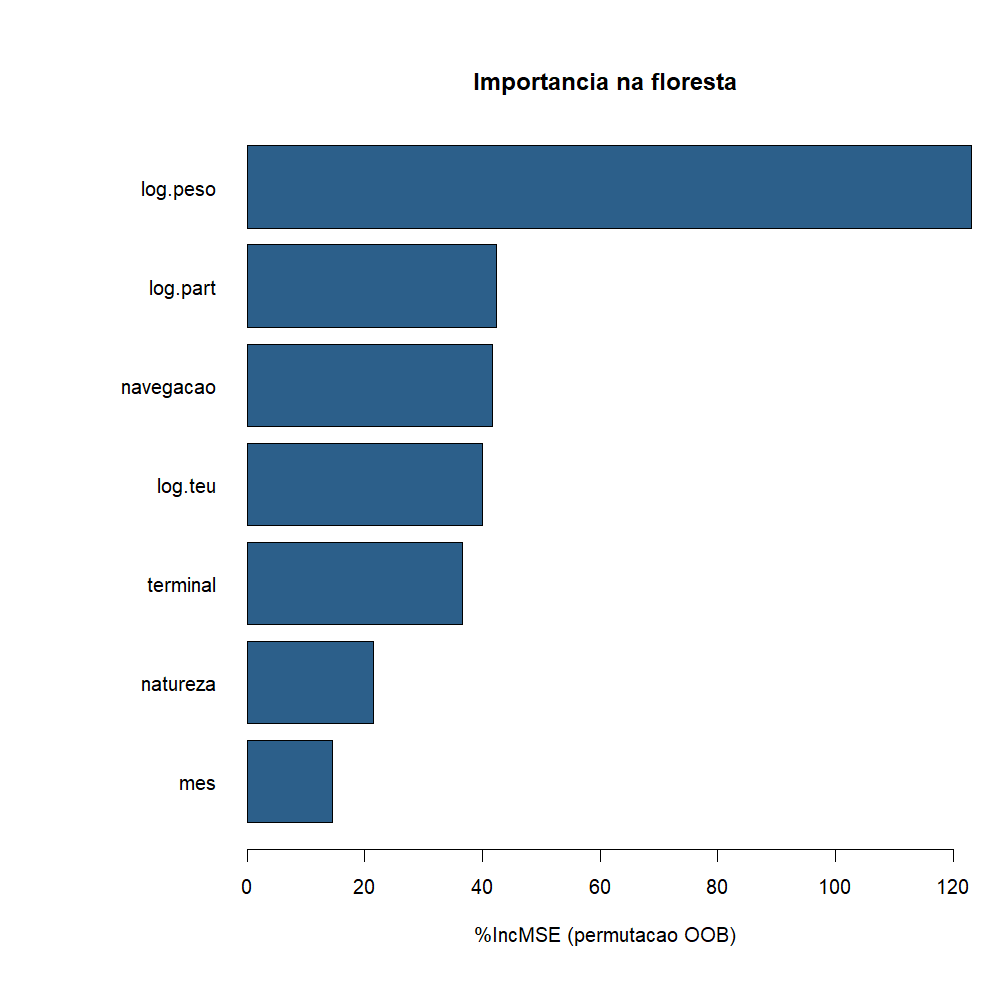
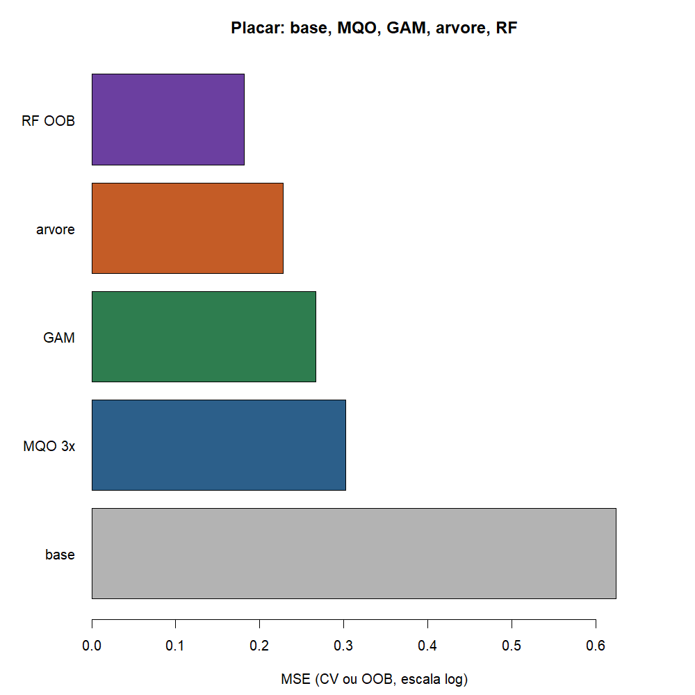

# Atividade 10 - Árvores de decisão e random forest

**Team Shannon · Teoria do Aprendizado Estatístico · Fatec Rubens Lara · Aula 11**

Continua a [09](09-splines-modelos-aditivos.md): o GAM soma curvas suaves e
supõe **aditividade**. A
[Aula 11](../materiais-aulas/Aula%2011%20-%20Árvores%20de%20Decisão%20e%20Random%20Forest.PDF)
relaxa isso: a árvore faz perguntas sim/não e a próxima pergunta pode
depender da anterior - interação "de graça".

Script: [`10-arvores-random-forest.R`](../estrutura/codigos/10-arvores-random-forest.R).
Números: [`10-numeros.txt`](../estrutura/codigos/10-numeros.txt).
Pacotes: R base (`data.table` na leitura), `rpart` e `randomForest` (exceções
do laboratório, no mesmo espírito do `mgcv` na 09).

---

## O funil

| # | Etapa | O que fizemos |
|---|---|---|
| 07 | Expandir e frear | `glmnet` |
| 08 | Suavizar | KNN, kernel |
| 09 | Splines / GAM | aditivo |
| 10 | Árvores / RF | **esta entrega**: poda, bagging, floresta |

Recorte da ficha da Entrega 1: Santos 2024, movimentação de carga, peso > 0,
T3 até P99, **n = 5.681 escalas**. Resposta e preditores:

| Papel | Variável |
|---|---|
| y | log(1 + T3) |
| numéricos | `log.peso`, `log.teu`, `log.part` |
| fatores | `natureza`, `navegacao`, `terminal`, `mes` |

Árvore e floresta aceitam `factor` sem criar dummies. As mesmas 5 dobras
(semente 1) do funil.

---

## 1. Árvore de regressão e poda

A árvore parte o espaço em retângulos. Em cada folha a previsão é a **média**
dos $y$ de treino. Cresce de forma **gulosa**: em cada nó escolhe o preditor
e o corte que mais baixam o RSS.

```math
\mathrm{RSS}=\sum_{j=1}^{J}\sum_{i:\,x_i\in R_j}(y_i-\hat y_{R_j})^{2}
```

Árvore cheia decora o treino. A poda custo-complexidade freia o número de
folhas $|T|$:

```math
C_{\alpha}(T)=\mathrm{RSS}(T)+\alpha|T|,
\qquad
\alpha=\mathrm{cp}\times\mathrm{RSS}(\mathrm{raiz})
```

No R: `rpart(..., cp = 0.001)` cresce; `cptable` + `prune` escolhem a
subárvore com menor erro de CV.





No nosso banco: **cp ≈ 0,00132**, **50 folhas**, CV(5) ≈ **0,2282**.
A **primeira pergunta** (raiz) é sobre **`log.teu`**: a árvore começa
separando escalas com TEU baixo (granéis / sem contêiner) das com TEU alto.
Perguntas seguintes usam peso, partidas, terminal e navegação - há
**interação**: o corte de peso que importa num ramo não é o mesmo do outro.

---

## 2. Classificação: impureza

Para resposta binária a folha prevê a classe mais comum e o critério vira
**impureza** (erro, Gini ou entropia). Queda de impureza = ganho. O `rpart`
usa Gini por padrão. Nesta entrega a resposta é contínua (T3); a impureza
entra nos exercícios.

---

## 3. Bagging, floresta, OOB e importância

Uma árvore é instável. O **bagging** média $B$ árvores grandes em amostras
bootstrap. A **random forest** ainda sorteia $m$ dos $p$ preditores em cada
nó (padrão: $m\approx\sqrt{p}$ ou $p/3$), para destecer a correlação entre
árvores.

Cada observação fica de fora de cerca de $e^{-1}\approx 37\%$ das árvores:
previsão **OOB** = validação "de graça". Usamos OOB para escolher `mtry`.



Com $p=7$: candidatos 2, 3, 4, 7. Melhor **mtry = 3**, OOB MSE = **0,1819**.



Importância por permutação (%IncMSE): `log.peso` lidera, depois `log.part`,
`navegacao`, `log.teu`, `terminal`. Isso diz quanto a floresta **usa** o
preditor - não a direção nem causalidade. A raiz da árvore única foi
`log.teu`; a floresta espalha o crédito e sobe o peso.

---

## 4. Placar



| Modelo | MSE |
|---|---:|
| linha de base | 0,6241 |
| MQO (3 numéricos) | 0,3019 |
| GAM (Aula 10) | 0,2669 |
| árvore podada (CV) | 0,2282 |
| **random forest (OOB)** | **0,1819** |

A floresta é o melhor placar do funil até aqui. Ganha do GAM porque entra
fatores (navegação, terminal, natureza, mês) e porque corta interações sem
pedir `ti()`. A árvore única já batia o GAM (0,228 vs 0,267); a floresta
ainda corta ~20% desse erro.

Para a pergunta da Entrega 1: TEU e peso continuam centrais, mas terminal e
navegação passam a contar de forma não aditiva - o tempo de operação depende
do **caminho** na árvore, não de um único $\beta$.

---

## 5. Exercícios (gabarito comentado)

### Exercício 1 (cálculo): RSS dos cortes

Áreas 50, 70, 90, 120, 150, 200; preços 200, 220, 260, 300, 310, 420.
RSS dos cortes em 80, 135 e 175?

**Gabarito.** Cortes em 80 / 135 / 175: RSS = **14.275 / 11.950 / 9.280**.
A árvore escolhe o de **175** (menor RSS entre os três): separa o 200 m²
(420) do bloco até 150.

### Exercício 2 (cálculo): impureza

Nó com 30 caros e 10 não. Erro, Gini e entropia? Compare divisões
(20,0)+(10,10) e (25,5)+(5,5) pelo erro e pelo Gini ponderados.

**Gabarito.** $p=30/40=0{,}75$:

```math
E=0{,}25,\quad G=2\cdot0{,}75\cdot0{,}25=0{,}375,\quad
D=-0{,}75\log_2 0{,}75-0{,}25\log_2 0{,}25\approx0{,}811
```

Divisão A (20,0)+(10,10): erro ponderado $=0{,}25$; Gini ponderado $=0{,}25$.
Divisão B (25,5)+(5,5): erro $=0{,}25$; Gini $\approx0{,}333$. Pelo Gini, A
é melhor (folha pura); pelo erro as duas empatam - por isso o Gini costuma
ser o padrão.

### Exercício 3 (cálculo): fração OOB

$(1-1/n)^n$ para $n=10$ e $n=1000$. Com 300 árvores e $n=1000$, de quantas
cada observação fica de fora, em média?

**Gabarito.** $0{,}3487$ e $0{,}3677$ (→ $e^{-1}$). Fora em média
$300\times0{,}3677\approx110$ árvores.

### Exercício 4 (cálculo): $C_\alpha$

Subárvores com 1, 4 e 12 folhas: RSS 900, 300, 200. Qual ganha com
$\alpha=10$, $50$ e $300$? Desde que $\alpha$ a de 4 vence a de 12?

**Gabarito.** Critério RSS + $\alpha|T|$:

| | $\alpha=10$ | $\alpha=50$ | $\alpha=300$ |
|---|---:|---:|---:|
| 1 folha | 910 | 950 | **1200** |
| 4 folhas | 340 | **500** | 1500 |
| 12 folhas | **320** | 800 | 3800 |

Com $\alpha=10$ ganha a de 12; com 50 a de 4; com 300 a de 1.
A de 4 vence a de 12 quando $300+4\alpha < 200+12\alpha$ ⇒ $\alpha>12{,}5$.

### Conceituais (porto)

**Guloso.** Não testa todas as partições porque o número explode. Uma
interação "só TEU alto **e** terminal X" pode perder a melhor primeira
pergunta global - a poda e a floresta mitigam.

**Interação de graça.** Depois de `log.teu < c`, a árvore pode perguntar
outra coisa que no ramo TEU alto; o GAM aditivo somaria $f(\mathrm{teu})$
igual para todos.

**Mais árvores × árvore maior.** Mais árvores no bagging média ruído (não
sobreajusta da mesma forma); mais folhas numa árvore única memoriza o treino.

**Sortear $m$.** Desteca árvores correlacionadas. Com $p=3$ (só numéricos)
$m$ quase não muda; com $p=7$ (fatores) `mtry=3` bateu `mtry=7` (bagging).

**Importância ≠ causa.** `log.peso` alto na importância não prova que
aumentar o peso cause mais T3 - só que embaralhar peso piora a previsão OOB.

---

## 6. Conclusão

1. Árvore = perguntas gulósas + média na folha; freio = poda ($\mathrm{cp}$).
2. Floresta = bagging + sorteio de $m$ por nó; freio = a média; validação = OOB.
3. Em Santos, raiz = `log.teu`; RF OOB **0,182** < árvore **0,228** < GAM **0,267**.
4. Próxima aula: agrupamento e PCA - exploração **sem** $Y$.

---

## Como reproduzir

```r
Rscript estrutura/codigos/10-arvores-random-forest.R
```

| Arquivo | Conteúdo |
|---|---|
| `01-arvore-podada.png` | árvore após `prune` |
| `02-cp-xerror.png` | caminho de poda |
| `03-oob-mtry.png` | OOB × mtry |
| `04-importancia-rf.png` | `%IncMSE` |
| `05-placar-cv.png` | base, MQO, GAM, árvore, RF |

*Fonte: ANTAQ, Santos 2024.*
