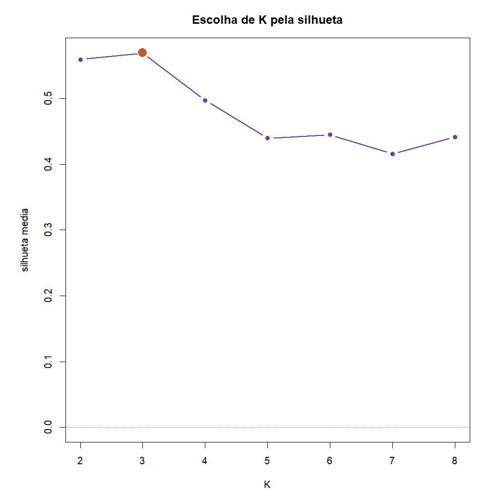
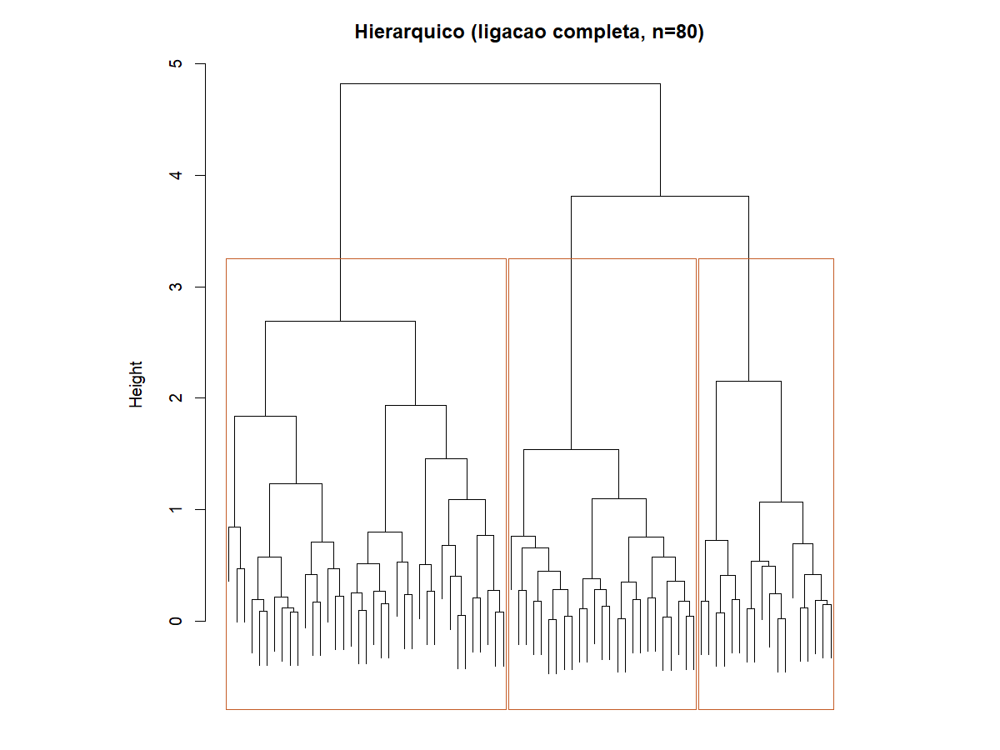
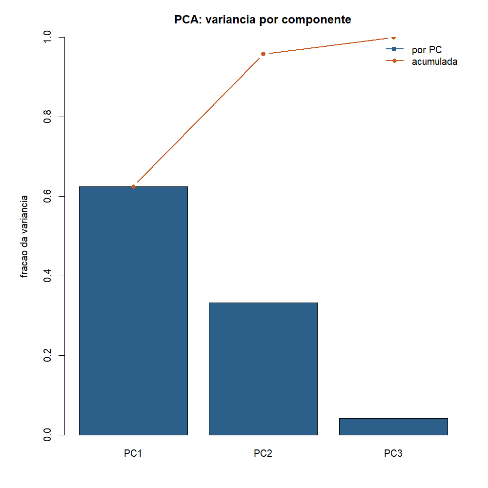
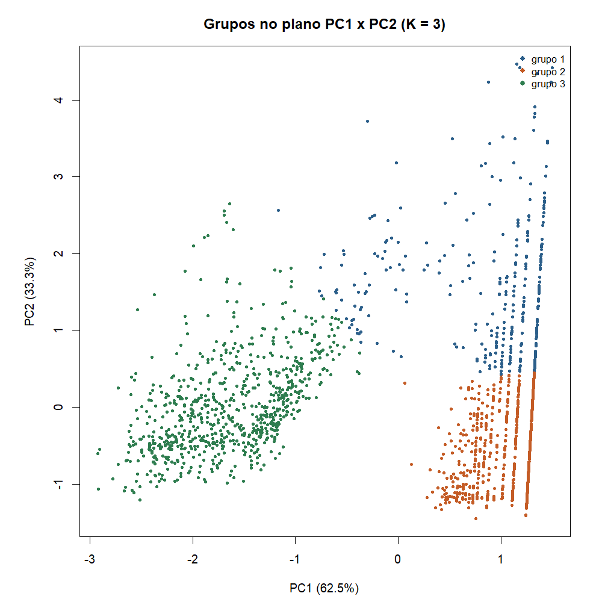
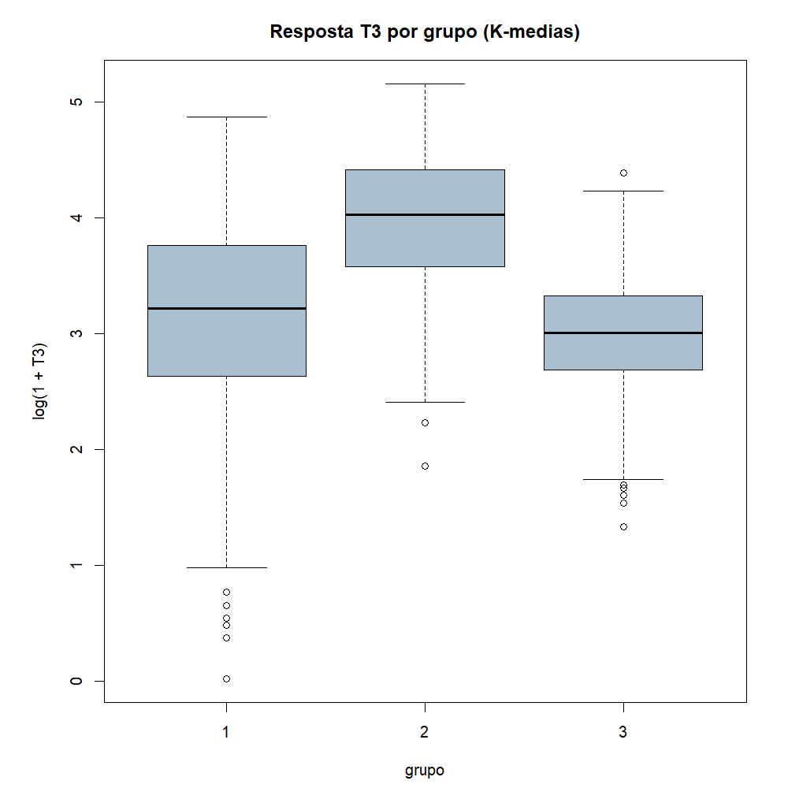

# Atividade 11 - Agrupamento e componentes principais

**Team Shannon · Teoria do Aprendizado Estatístico · Fatec Rubens Lara · Aula 12**

Continua a [10](10-arvores-random-forest.md): até aqui sempre havia $Y$ (T3).
A
[Aula 12](../materiais-aulas/Aula%2012%20-%20Agrupamento%20e%20Componentes%20Principais.PDF)
abre o **não supervisionado**: só os preditores - grupos e direções que
resumem colunas.

Script: [`11-agrupamento-pca.R`](../estrutura/codigos/11-agrupamento-pca.R).
Números: [`11-numeros.txt`](../estrutura/codigos/11-numeros.txt).
Pacotes: só R base (`data.table` na leitura; `kmeans`, `hclust`, `prcomp`)
mais a função `silhueta()` do slide da aula.

---

## O funil

| # | Etapa | O que fizemos |
|---|---|---|
| 09 | Splines / GAM | com $Y$ |
| 10 | Árvores / RF | com $Y$ |
| 11 | Agrupamento / PCA | **esta entrega**: sem $Y$ na matriz |

Recorte: Santos 2024, movimentação de carga, peso > 0, T3 ≤ P99.
Matriz $X$: só `log.peso`, `log.teu`, `log.part` (**sem** a resposta).
Amostra de **2.000** escalas (`set.seed(1)`) para a silhueta (matriz $n\times n$).

---

## 1. Padronização e distância

Sem padronizar, a coluna de unidade maior manda na distância euclidiana.
Aqui as três já estão em log, mas ainda têm escalas diferentes - usamos
`scale()` / `prcomp(..., scale. = TRUE)`.

```math
z_{ij}=\frac{x_{ij}-\bar x_j}{s_j},
\qquad
d(x_i,x_{i'})=\sqrt{\sum_j(z_{ij}-z_{i'j})^{2}}
```

---

## 2. K-médias, cotovelo e silhueta

O K-médias minimiza a soma de quadrados dentro dos grupos:

```math
W=\sum_{k=1}^{K}\sum_{i\in C_k}\|x_i-\bar x_k\|^{2}
```

Mais $K$ sempre baixa $W$ (com $K=n$, $W=0$) - por isso $W$ sozinho não
escolhe $K$. A **silhueta** média $s(i)\in[-1,1]$ mede se cada ponto está
melhor no próprio grupo do que no vizinho.



| $K$ | 2 | 3 | 4 | 5 | 6 | 7 | 8 |
|---|---:|---:|---:|---:|---:|---:|---:|
| silhueta | 0,559 | **0,569** | 0,497 | 0,440 | 0,445 | 0,416 | 0,442 |

Escolhemos **$K=3$** (máximo). Silhueta ≈ 0,57: grupos existem de forma
razoável (não é 0,9, mas também não é ruído puro).

Centros nas unidades originais (amostra):

| Grupo | nome | n | log.peso | log.teu | log.part | y médio |
|---|---|---:|---:|---:|---:|---:|
| 2 | pouco-TEU | 866 | 10,55 | ≈0 | 1,31 | 3,99 |
| 1 | intermediário | 367 | 8,09 | 0,82 | 1,53 | 3,13 |
| 3 | muito-TEU | 767 | 9,92 | 7,49 | 4,95 | 3,00 |

Leitura portuária: **pouco-TEU** ≈ granéis pesados (quase sem contêiner),
T3 mais alto; **muito-TEU** ≈ operações com contêiner e muitas partidas,
T3 médio menor; intermediário no meio.

---

## 3. Hierárquico

Aglomerativo com ligação **completa**: junta os pares pela maior distância
entre membros. Determinístico; o corte define $K$.



(Amostra de 80 pontos só para desenhar.)

---

## 4. PCA

```math
\mathrm{PC}_1=\phi_{11}z_1+\cdots+\phi_{p1}z_p,\quad\sum_j\phi_{j1}^{2}=1
```



| PC | Fração | Acumulada | Leitura dos pesos |
|---|---:|---:|---|
| PC1 | **62,5%** | 62,5% | `log.teu` e `log.part` (~ −0,71 cada): **eixo contêiner / partidas** |
| PC2 | 33,3% | 95,8% | quase só `log.peso` (~ −1): **eixo tonelagem** |
| PC3 | 4,2% | 100% | resto |

Duas componentes guardam ~96% da variação das três colunas. Nomes: PC1 =
"perfil contêiner"; PC2 = "peso bruto". O sinal dos pesos é arbitrário.



Os três grupos do K-médias se separam bem nesse plano: pouco-TEU vs muito-TEU
ao longo da PC1; o peso (PC2) ajuda o intermediário.



A resposta **muda** entre grupos (médias 3,99 / 3,13 / 3,00 na escala log).
O rótulo do grupo pode virar preditor categórico numa regressão depois -
exploração vira feature. A PCA **não olhou** $Y$: se PC1 for boa para
prever T3, isso se confere com CV (como na 05/06), não pelo % de variância.

---

## 5. Exercícios (gabarito comentado)

### Exercício 1 (cálculo): K-médias à mão

Áreas 50, 60, 70, 140, 150, 160, 250. Partindo dos centros 50 e 60 com
$K=2$, o algoritmo junta o bloco baixo {50,60,70} e o alto {140…250} (ou
vizinhos próximos conforme as iterações). $W$ de $K=3$ é menor que o de
$K=2$: **$W$ sozinho não escolhe $K$** porque sempre cai ao acrescentar um
grupo.

### Exercício 2 (cálculo): silhueta do 160

Com grupos {50,60,70}, {140,150,160}, {250}: o 160 está no grupo do meio;
o vizinho costuma ser o {250} ou o baixo, conforme as distâncias - $a(i)$ é
a média aos outros do próprio grupo; $b(i)$ a menor média a outro grupo;
$s(i)=(b-a)/\max(a,b)$.

### Exercício 3 (cálculo): ligações

Com ligação **simples**, o 80 entra cedo (encadeamento); com **média** /
**completa**, entra mais alto. A última junção une os dois grandes blocos
na altura da maior (completa) ou média das distâncias entre eles.

### Exercício 4 (cálculo): PCA com $r=0{,}6$

```math
\frac{1+r}{2}=\frac{1{,}6}{2}=0{,}8
\qquad
\mathrm{PC}_1=\frac{z_1+z_2}{\sqrt{2}}
\qquad
\mathrm{PC}_1(2,1)=\frac{3}{\sqrt{2}}\approx2{,}121
```

PC1 guarda **80%** da variância das duas colunas.

### Conceituais (porto)

**Escala.** Sem padronizar, `log.peso` (valores ~8–11) dominaria `log.teu`
quando TEU ≈ 0. Em metros, distância física dominaria tudo.

**Grupos que não existem.** O algoritmo sempre devolve $K$ grupos. Validamos
com silhueta (aqui 0,57) e com o boxplot de $Y$: se $Y$ não muda, o grupo
não ajuda a pergunta.

**Simples × completa.** Simples encadeia pontos isolados; completa exige que
**todos** os pares entre clusters estejam perto.

**PC1 e o preço / T3.** 62% da variação de $X$ não implica melhor preditor de
T3 - a PCA não viu $Y$.

**Duas maneiras de usar o agrupamento.** (1) preditor categórico na regressão
de T3; (2) modelos separados por perfil (pouco-TEU vs muito-TEU), como a
interação que a árvore já cortava na 10.

---

## 6. Conclusão

1. Não supervisionado: estrutura em $X$, sem rótulo de erro.
2. Em Santos ($n=2000$ amostrados): silhueta máxima em **$K=3$** (0,57);
   grupos alinhados a TEU/partidas vs granel.
3. PCA: PC1 = contêiner/partidas (62,5%); PC2 = peso (33,3%); ~96% em 2 PCs.
4. T3 difere entre grupos - o agrupamento é exploração útil para a Entrega 1,
   não substitui a previsão supervisionada das aulas 09-10.

---

## Como reproduzir

```r
Rscript estrutura/codigos/11-agrupamento-pca.R
```

| Arquivo | Conteúdo |
|---|---|
| `01-pca-variancia.png` | fração e acumulada |
| `02-silhueta-por-k.png` | escolha de $K$ |
| `03-pc1-pc2-grupos.png` | grupos no plano PCA |
| `04-boxplot-y-por-grupo.png` | T3 por grupo |
| `05-dendrograma.png` | hierárquico (n = 80) |

*Fonte: ANTAQ, Santos 2024.*
